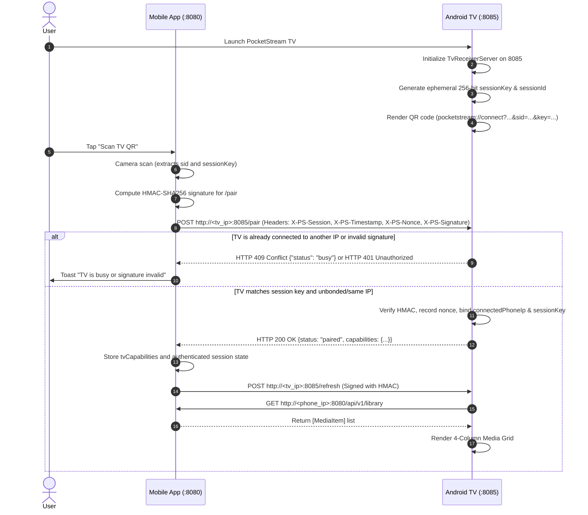
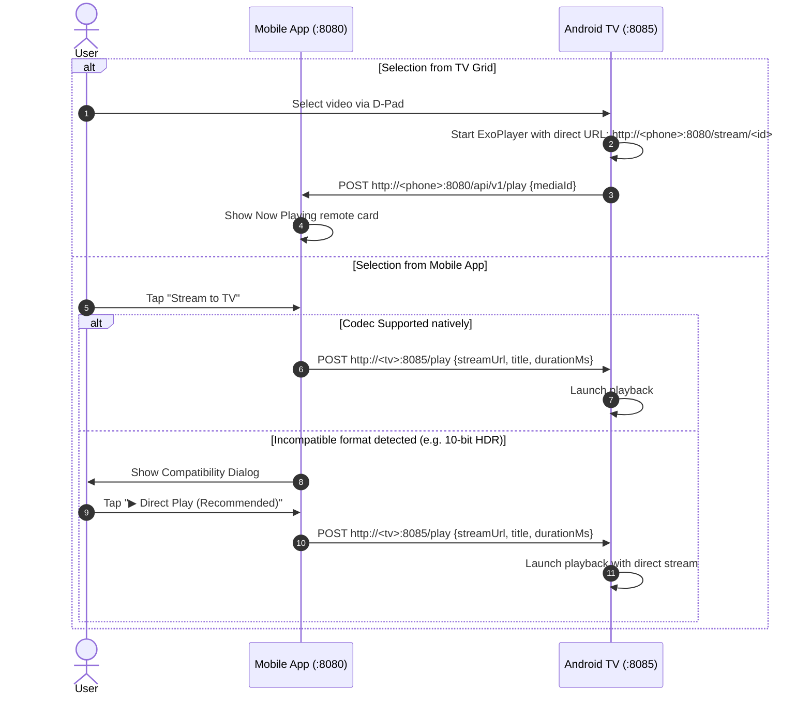
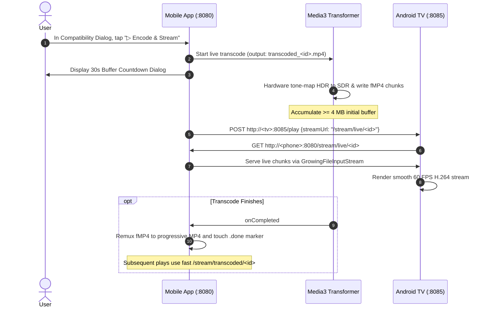

# PocketStream System Architecture

## 1. Executive Summary & Top-Level Architecture
PocketStream is a peer-to-peer, local-network media streaming and remote control system designed for high-bitrate video transmission from mobile devices (Android and iOS) to smart TV receivers (Android TV / Google TV).

The architecture eliminates all cloud dependencies, accounts, and external servers. All discovery, pairing, metadata ingestion, video transcoding, and streaming occur directly over local Wi-Fi.

```
       +---------------------------------------------------------+
       |                     Local Wi-Fi (LAN)                   |
       +---------------------------------------------------------+
                     |                                 |
         mDNS (5353) / UDP (8088)           mDNS (5353) / UDP (8088)
         QR Scheme Pairing                  QR Display
                     v                                 v
        +-------------------------+       +-------------------------+
        |   Mobile Client (8080)  |       |   TV Receiver (8085)    |
        |  (Android / iOS)        |       |      (Android TV)       |
        |                         |       |                         |
        | +---------------------+ |       | +---------------------+ |
        | | PocketHttpServer    | |<======| | ExoPlayer Engine    | |
        | | (NanoHTTPD / NW)    | | HTTP  | | (Media3 1.3.1)      | |
        | +---------------------+ | 8080  | +---------------------+ |
        |                         |       |                         |
        | +---------------------+ |       | +---------------------+ |
        | | TranscoderManager   | |       | | TvReceiverServer    | |
        | | (Media3 Transformer)| |======>| | (NanoHTTPD 8085)    | |
        | +---------------------+ | HTTP  | +---------------------+ |
        |                         | 8085  |                         |
        | +---------------------+ |       | +---------------------+ |
        | | MediaRepository     | |       | | TvMediaAdapter Grid | |
        | | (SAF & Exclude Set) | |       | | (4-Column Layout)   | |
        | +---------------------+ |       | +---------------------+ |
        +-------------------------+       +-------------------------+
```

---

## 2. Repository & Workspace Topology

The repository contains three client applications and a shared protocol library:

```
PocketStream/
├── apps/
│   ├── mobile/                  # Android Mobile Application (Kotlin)
│   │   ├── build.gradle         # Namespace: com.pocketstream.mobile
│   │   └── src/main/...
│   └── tv/                      # Android TV Application (Kotlin)
│       ├── build.gradle         # Namespace: com.pocketstream.tv
│       └── src/main/...
├── ios/
│   ├── PocketStream/            # iOS Application (Swift 5.9, SwiftUI)
│   │   ├── App/                 # App lifecycle (PocketStreamApp.swift)
│   │   ├── Server/              # Embedded HTTP server (Network.framework)
│   │   ├── Storage/             # Media bookmarking & metadata
│   │   ├── Transcoder/          # AVFoundation transcode pipeline
│   │   └── Views/               # SwiftUI interfaces
│   └── PocketStream.xcodeproj   # Xcode project definition
├── shared/
│   └── protocol/                # Shared JVM/Kotlin data contracts
│       ├── build.gradle         # Namespace: com.pocketstream.protocol
│       └── src/main/...         # MediaItem, TvCapabilities, etc.
└── docs/                        # Canonical system documentation
```

---

## 3. Subsystem Breakdown

### 3.1 Android Mobile Application (`apps/mobile`)
- **Package**: `com.pocketstream.mobile`
- **Minimum SDK**: 26 (Android 8.0 Oreo); **Target/Compile SDK**: 34 (Android 14)
- **Primary Modules**:
  - `ServerService`: Foreground service managing `PocketHttpServer`, displaying persistent notification with playback controls, and acquiring Wi-Fi and wake locks.
  - `PocketHttpServer`: Custom embedded HTTP server based on NanoHTTPD 2.3.1. Handles byte-range streaming, live chunk streaming via `GrowingFileInputStream`, and REST endpoints.
  - `MediaRepository`: Manages user-selected folder trees and files via Android Storage Access Framework (`DocumentFile`, `ContentResolver`). Probes 10-bit status using `MediaExtractor` and generates thumbnails at 7% timeline position.
  - `TranscoderManager`: Wraps AndroidX Media3 Transformer to convert high-profile/HDR video into fragmented MP4 chunks with H.264 High Profile and AAC stereo.
  - `MobileDiscoveryManager`: Handles mDNS registration/discovery and UDP broadcast announcements on port 8088.

### 3.2 Android TV Application (`apps/tv`)
- **Package**: `com.pocketstream.tv`
- **Minimum SDK**: 26; **Target/Compile SDK**: 34
- **Primary Modules**:
  - `TvReceiverServer`: Embedded NanoHTTPD server on port 8085 handling `/pair`, `/capabilities`, `/disconnect`, `/refresh`, `/play`, `/control`, and `/status`. Enforces single-phone connection exclusivity.
  - `ExoPlayerManager`: Wraps Media3 ExoPlayer for video rendering, supporting H.264, HEVC, VP9, AV1, audio track switching, subtitle rendering, and D-Pad timeline scrubbing.
  - `TvMediaAdapter`: 4-column `GridLayoutManager` recycler view adapter with on-demand image loading via OkHttp and an in-memory LruCache.
  - `TvCapabilityDetector`: Queries Android `MediaCodecList` to report display dimensions, frame rates, and supported video MIME types to mobile clients.

### 3.3 iOS Client (`ios/PocketStream`)
- **Language**: Swift 5.9; **Deployment Target**: iOS 16.0+
- **Architecture**: SwiftUI MVVM with concurrency (`async/await`)
- **Primary Modules**:
  - `PocketHttpServer.swift`: Custom asynchronous HTTP 1.1 server implemented directly on Apple's `Network.framework` (`NWListener` and `NWConnection`).
  - `MediaRepository.swift`: Ingests video items via SwiftUI `fileImporter`, persisting access using security-scoped URL bookmarks. Extracts metadata and thumbnails via `AVAsset` / `AVAssetImageGenerator`.
  - `TranscoderManager.swift`: Handles on-device transcoding via `AVAssetExportSession` / `AVAssetReader` & `AVAssetWriter`.
  - `MobileDiscoveryManager.swift`: Performs mDNS service registration (`NWListener`) and UDP discovery.

### 3.4 Shared Protocol Module (`shared/protocol`)
- **Package**: `com.pocketstream.protocol`
- **Artifact**: Java/Kotlin library consumed by both `apps/mobile` and `apps/tv`.
- **Contracts**:
  - `MediaItem`: Represents media metadata (id, title, size, MIME type, duration, width, height, videoCodec, audioCodec, streamPath, thumbnailPath).
  - `TvCapabilities`: Represents TV hardware decoder limits (maxWidth, maxHeight, maxFps, supports10BitHevc, supportsHdr, supports4K, supportedVideoMimes, hardwareDecoders).
  - `PlaybackControl`: Defines control payloads (`PLAY`, `PAUSE`, `RW`, `FF`, `RESTART`, `STOP`, `SEEK`, `PREPARING_SEEK`).
  - `ServerStatus`: Operational health and IP address metadata.
  - `DiscoveryMessage`: JSON formats for UDP broadcasts (`DISCOVER_TV`, `TV_ANNOUNCE`, `PHONE_ANNOUNCE`, `TV_BUSY`, `PHONE_DISCONNECT`).

---

## 4. End-to-End User Journey Flows

### 4.1 Discovery and Exclusive Pairing Flow (Option C Optical PSK)



---

### 4.2 Direct Playback Initiation Flow (Preferred in All Cases)



---

### 4.3 Hardware Transcoding Flow (Fallback when Requested)



---

## 5. Transcoding & Streaming Engine Architecture

### 5.1 Fragmented MP4 vs Progressive MP4
To achieve zero-lag live playback while the hardware encoder is actively transcoding:
1. **Live Phase (fMP4)**: Media3 `InAppMuxer` is initialized with `.setFragmentedMp4Enabled(true)`. The `ftyp` and `moov` header boxes are written immediately at file creation, and subsequent video samples are packaged into 1-second `moof` + `mdat` fragments.
2. **Growing File Streaming**: `GrowingFileInputStream` monitors file length and holds the read thread with 25ms polling intervals when waiting for the hardware encoder to output fresh fragments.
3. **Completion & Progressive Conversion**: Upon completion, the file is remuxed into a standard progressive MP4 with a single contiguous `moov` atom at the start of the file. This allows subsequent sessions to enjoy full HTTP 206 Partial Content byte-range seeking.

### 5.2 10-bit Technical Analysis Architecture
Rather than brittle file extension or filename string searching, the architecture analyzes the track container:
- Probes `MediaMetadataRetriever.METADATA_KEY_COLOR_TRANSFER` (6 = ST2084 / HDR10, 7 = HLG).
- Probes `MediaMetadataRetriever.METADATA_KEY_COLOR_STANDARD` (6 = BT.2020).
- Probes `MediaExtractor` track format for `KEY_PROFILE` (HEVC Profile Main 10, AVC High 10, VP9 Profile 2/3, AV1 Main 10).
- Probes track integer attributes `bits-per-sample` and `bit-depth`.
